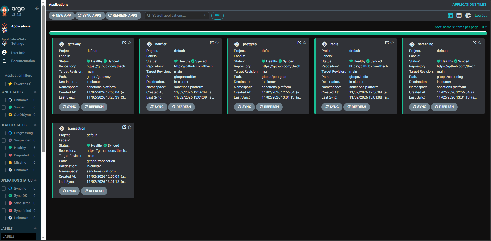

# ComplianceOps

ComplianceOps is a policy-gated Kubernetes delivery platform: Terraform-provisioned
AWS infrastructure, ArgoCD-driven GitOps delivery, and Kyverno admission guardrails with
secrets from AWS Secrets Manager (in progress, Phase 07) for four independently deployed microservices. This repo is the hub —
infrastructure, GitOps manifests, policies, observability config, and architecture
docs live here; application code lives in the four complianceops-service repos.

## Links for the 4 services:

1. Gateway Service : https://github.com/thechawla225/complianceops-gatewayservice

2. Transaction Service : https://github.com/thechawla225/complianceops-transactionservice

3. Screening Service : https://github.com/thechawla225/complianceops-screeningservice

4. Notifier Service : https://github.com/thechawla225/complianceops-notifierservice

verify-round-trip.ps1 -> this script validates the connection between gateway and the transaction service

## Deployment

Argo CD deploys every chart in `gitops/` from `main`; there is no manual deploy step. A merged service PR
reaches the cluster in about 7 minutes. See the [runbook](docs/runbook.md) for bring-up, teardown, rollback and
troubleshooting, and [ADR 0008](docs/adr/0008-argocd-installed-by-terraform.md) for the design and results.

